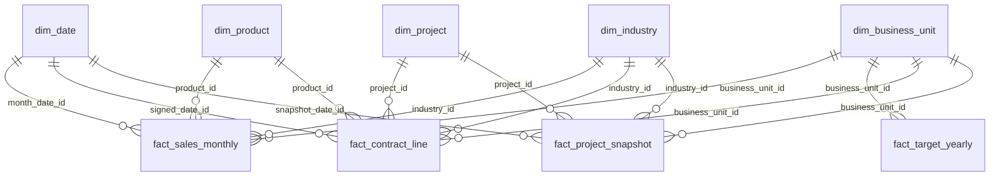

# 简化销售经管数仓设计

依据：根目录 index.html 的 fields2026/fieldsGoal/fieldsPPL、历史示例问题和 genAiReply。

模型包含五张维度表、四张事实表；合同事件和风险快照分开，避免快照重复统计签约额。
收入与销量采用月度粒度；原型的 1月…12月宽表列转换成日期维度，不重复存季度/全年汇总。
产品线、省份/城市/大区、客户名称分别并入产品、经营单元、项目维度，减少维表数量。

## 示例问题与数据来源

| 示例 | 来源 |
| --- | --- |
| 产品线销售、北京产品线收入、深圳产品销售、产品型号排名 | fact_sales_monthly + dim_date/business_unit/product |
| 政企收入范围筛选及行业占比 | fact_sales_monthly + dim_industry，聚合后 HAVING |
| 各经营单元收入与完成率 | 收入先按年/单元汇总，再关联 fact_target_yearly |
| 商业目标与商解目标 TOP5 | fact_target_yearly + dim_business_unit |
| 产品线/经营单元同比趋势 | fact_sales_monthly 同维度同期间跨年比较 |
| 每月合同金额趋势 | fact_contract_line + dim_date，通过 signed_date_id |
| 当前高风险项目数量、明细 | fact_project_snapshot 每项目最新有效快照 + dim_project |

## 关联结构

年度目标只按 target_year 与汇总收入的年份匹配，不建立到日期维度某一天的外键。
事实表共享维度；多个事实表先各自聚合到共同粒度，再关联，避免明细相乘。

## 表、字段与主外键

### dim_date（维度表）

粒度：一自然日一行。主键：`date_id`。

日期维度；date_id 为 YYYYMMDD。分析月份/季度从此表分组；已确认收入数据截止 2026-05-31。

| 字段 | 类型 | 键/角色 | 含义 |
| --- | --- | --- | --- |
| date_id | INT | PK | 日期编码 YYYYMMDD。 |
| calendar_date | DATE | dimension | 自然日期。 |
| year | SMALLINT | dimension | 自然年。年度目标以 target_year 直接关联此年份，不按每一天连接目标。 |
| quarter | TINYINT | dimension | 季度，1 至 4。 |
| month | TINYINT | dimension | 月份，1 至 12。 |
| day | TINYINT | dimension | 日，1 至 31。 |

其他约束：`UNIQUE KEY uq_calendar_date (calendar_date)`；`CHECK (quarter BETWEEN 1 AND 4)`；`CHECK (month BETWEEN 1 AND 12)`；`CHECK (day BETWEEN 1 AND 31)`。

### dim_business_unit（维度表）

粒度：一经营单元一行。主键：`business_unit_id`。

经营单元维度，合并省份/城市/区域属性。北京、深圳等城市筛选使用 city；代表处名称使用 business_unit_name。

| 字段 | 类型 | 键/角色 | 含义 |
| --- | --- | --- | --- |
| business_unit_id | INT | PK | 经营单元唯一编号。 |
| business_unit_name | VARCHAR(80) | dimension | 经营单元全称，如北京代表处、川藏代表处。 |
| province | VARCHAR(40) | dimension | 所属省级区域；川藏为简化区域名称。 |
| city | VARCHAR(40) | dimension | 经营单元驻地城市。 |
| region_name | VARCHAR(40) | dimension | 销售大区，如华北、华东、华南。 |

其他约束：`UNIQUE KEY uq_unit_name (business_unit_name)`。

### dim_product（维度表）

粒度：一产品型号一行。主键：`product_id`。

产品维度；产品线作为属性直接保存在本表，避免增加产品线维表。销售/合同通过 product_id 关联本表。

| 字段 | 类型 | 键/角色 | 含义 |
| --- | --- | --- | --- |
| product_id | INT | PK | 产品唯一编号。 |
| product_model | VARCHAR(80) | dimension | 产品型号，如 R5300 G5；不等同于产品线。 |
| product_line | VARCHAR(40) | dimension | 通用计算、智能计算、存储、商业解决方案。政企解决方案在本 demo 归入商业解决方案。 |
| product_type | VARCHAR(40) | dimension | 产品类型，如服务器、存储、解决方案。 |
| is_new_product | TINYINT | dimension | 是否新产品，1 是，0 否。 |

其他约束：`UNIQUE KEY uq_product_model (product_model)`；`CHECK (is_new_product IN (0, 1))`。

### dim_industry（维度表）

粒度：一行业小类一行。主键：`industry_id`。

行业维度，行业大类和行业名称同时保留。原型的政企筛选对应 industry_category='政企'，不能把政企当作所有行业的小类名称。

| 字段 | 类型 | 键/角色 | 含义 |
| --- | --- | --- | --- |
| industry_id | INT | PK | 行业唯一编号。 |
| industry_category | VARCHAR(40) | dimension | 行业大类：政企、商业市场、运营商。 |
| industry_name | VARCHAR(40) | dimension | 行业小类，如数字政府、金融、互联网。 |

其他约束：`UNIQUE KEY uq_industry (industry_category, industry_name)`。

### dim_project（维度表）

粒度：一项目一行。主键：`project_id`。

PPL 项目基础信息；风险和阶段保存于 fact_project_snapshot，实际合同保存于 fact_contract_line。项目可能尚未签约或拥有多条合同明细。

| 字段 | 类型 | 键/角色 | 含义 |
| --- | --- | --- | --- |
| project_id | INT | PK | 项目唯一编号。 |
| opportunity_no | VARCHAR(40) | dimension | 预销售/机会点编号。 |
| project_name | VARCHAR(120) | dimension | 项目名称。 |
| customer_name | VARCHAR(120) | dimension | 最终客户名称，简化为项目属性。 |
| sales_owner | VARCHAR(40) | dimension | 项目销售负责人。 |

其他约束：`UNIQUE KEY uq_opportunity (opportunity_no)`。

### fact_sales_monthly（事实表）

粒度：一月份 × 经营单元 × 产品型号 × 行业一行。主键：`sales_id`。

月度已确认收入及销量；month_date_id 是月末 date_id，关联 dim_date.date_id。只保存已发生的当月增量，不存累计数。金额为不含税人民币元；截止 2026-05-31，有 2025/2026 年同期间数据。

| 字段 | 类型 | 键/角色 | 含义 |
| --- | --- | --- | --- |
| sales_id | BIGINT | PK | 月度销售事实唯一编号。 |
| month_date_id | INT | FK → dim_date.date_id | 收入/销量归属月的月末日期；关联 dim_date.date_id。 |
| business_unit_id | INT | FK → dim_business_unit.business_unit_id | 收入归属经营单元；关联 dim_business_unit.business_unit_id。 |
| product_id | INT | FK → dim_product.product_id | 收入归属产品型号；关联 dim_product.product_id。 |
| industry_id | INT | FK → dim_industry.industry_id | 客户行业；关联 dim_industry.industry_id。 |
| revenue_amount | DECIMAL(18,2) | measure | 当月已确认不含税收入，单位元。销售额默认使用此字段；不是合同签约额。 |
| sales_quantity | INT | measure | 当月销售数量，单位台套。销售最多按数量排名；按销售额排名需使用 revenue_amount。 |

其他约束：`UNIQUE KEY uq_sales_grain (month_date_id, business_unit_id, product_id, industry_id)`；`CHECK (revenue_amount >= 0)`；`CHECK (sales_quantity >= 0)`。

### fact_target_yearly（事实表）

粒度：一年度 × 经营单元一行。主键：`target_year, business_unit_id`。

年度目标；联合主键 target_year/business_unit_id。商业目标=不含税签约额，商解目标=商业解决方案不含税收入；原型未明确收入完成率分母，另设 revenue_target_amount 作为总收入目标。无产品线/行业目标粒度，不能把全单元目标当成某产品线目标。

| 字段 | 类型 | 键/角色 | 含义 |
| --- | --- | --- | --- |
| target_year | SMALLINT | PK | 目标年度，也是联合主键的一部分。与汇总收入年份匹配，不关联 dim_date 每一天。 |
| business_unit_id | INT | PK；FK → dim_business_unit.business_unit_id | 联合主键另一部分，目标所属经营单元；关联 dim_business_unit.business_unit_id。 |
| commercial_target_amount | DECIMAL(18,2) | measure | 全年不含税签约额目标，元。原型商业目标(万元)乘 10000 后入库。 |
| solution_target_amount | DECIMAL(18,2) | measure | 全年商业解决方案产品线不含税收入目标，元。 |
| revenue_target_amount | DECIMAL(18,2) | measure | 全年总收入目标，元；为收入完成率明确补充的 demo 假设，不等同于商业目标。 |

其他约束：`CHECK (target_year BETWEEN 2000 AND 2100)`；`CHECK (commercial_target_amount >= 0)`；`CHECK (solution_target_amount >= 0)`；`CHECK (revenue_target_amount >= 0)`。

### fact_contract_line（事实表）

粒度：一合同 × 明细行一行。主键：`contract_line_id`。

实际已签约合同明细；contract_no/line_no 唯一，合同可有多个产品。金额为该行不含税元，不能在每一行重复存合同总额；合同数 COUNT(DISTINCT contract_no)。通过 signed_date_id 统计签约月份，不用项目快照月份代替。

| 字段 | 类型 | 键/角色 | 含义 |
| --- | --- | --- | --- |
| contract_line_id | BIGINT | PK | 合同明细唯一编号。 |
| contract_no | VARCHAR(40) | dimension | 合同编号；同一合同在不同明细行重复出现。 |
| line_no | SMALLINT | dimension | 合同内明细行号。 |
| project_id | INT | FK → dim_project.project_id | 合同关联项目；关联 dim_project.project_id。 |
| signed_date_id | INT | FK → dim_date.date_id | 合同实际签订日期；关联 dim_date.date_id。 |
| business_unit_id | INT | FK → dim_business_unit.business_unit_id | 合同签约业绩归属经营单元；关联 dim_business_unit.business_unit_id。 |
| product_id | INT | FK → dim_product.product_id | 合同明细产品型号；关联 dim_product.product_id。 |
| industry_id | INT | FK → dim_industry.industry_id | 合同客户行业；关联 dim_industry.industry_id。 |
| contract_quantity | INT | measure | 本合同明细的签约数量；不等同于当月确认销量。 |
| contract_amount | DECIMAL(18,2) | measure | 本明细不含税签约金额，元；月度合同趋势及商业完成率使用此字段。 |

其他约束：`UNIQUE KEY uq_contract_line (contract_no, line_no)`；`CHECK (contract_quantity > 0)`；`CHECK (contract_amount >= 0)`。

### fact_project_snapshot（事实表）

粒度：一快照日期 × 项目一行。主键：`snapshot_date_id, project_id`。

PPL 项目阶段与风险快照。联合主键 snapshot_date_id/project_id。快照不是事件流水，同一项目多个快照不能累加。当前风险须先取每个项目最近一条快照，再筛选 is_active=1 和风险等级。最新演示快照 2026-05-31。

| 字段 | 类型 | 键/角色 | 含义 |
| --- | --- | --- | --- |
| snapshot_date_id | INT | PK；FK → dim_date.date_id | 风险状态观察日期，联合主键的一部分；关联 dim_date.date_id。 |
| project_id | INT | PK；FK → dim_project.project_id | 联合主键另一部分，观察项目；关联 dim_project.project_id。 |
| business_unit_id | INT | FK → dim_business_unit.business_unit_id | 快照时项目所属经营单元；关联 dim_business_unit.business_unit_id。 |
| industry_id | INT | FK → dim_industry.industry_id | 快照时项目客户行业；关联 dim_industry.industry_id。 |
| project_stage | VARCHAR(20) | dimension | 商机、方案、投标、商务、签约、交付、完成。 |
| risk_level | VARCHAR(20) | dimension | 项目整体风险等级：低风险、中风险、高风险。 |
| competition_risk | VARCHAR(20) | dimension | 竞争风险等级。 |
| signing_risk | VARCHAR(20) | dimension | 合同签订风险等级。 |
| delivery_risk | VARCHAR(20) | dimension | 供应与交付风险等级。 |
| is_active | TINYINT | dimension | 是否仍在跟进，1 是；完成/关闭项目为 0，默认当前风险统计排除。 |
| risk_description | VARCHAR(255) | dimension | 项目进展及风险说明，不据此生成无数据依据的预测。 |

其他约束：`CHECK (is_active IN (0, 1))`；`CHECK (risk_level IN ('低风险', '中风险', '高风险'))`；`CHECK (competition_risk IN ('低风险', '中风险', '高风险'))`；`CHECK (signing_risk IN ('低风险', '中风险', '高风险'))`；`CHECK (delivery_risk IN ('低风险', '中风险', '高风险'))`。

## 口径与简化假设

- 所有金额为不含税人民币元，展示万元时除以 10000；使用 DECIMAL(18,2)。
- 原型仅列出商业目标/商解目标名称，未定义其计算口径；本演示将商业目标解释为合同签约额目标，商解目标解释为商业解决方案收入目标，实际业务需确认。
- 原型没有明确总收入目标，新增 revenue_target_amount，并与前两类目标分开；这是明确的 demo 假设。
- 月度销量也是合成演示度量，不能把源表合同台套数直接复制到每月；实际接入需按销售发生月份分配。
- 北京/深圳筛选按经营单元驻地城市，不能解释为最终客户所在地；本简化模型不分析客户地址。
- 年度目标没有产品/行业粒度，也不按月重复存储。完成率分母为全年目标；合并单元先求总金额再求比例。
- 同比默认比较 2026/2025 年 1-5 月；对未发生月份返回无数据，不能把未来日期维度当成收入事实。
- 当前风险以每个项目最近快照为准，再排除已完成项目；历史高风险不能直接累加。
- 合同按明细金额累加，合同数量去重；风险快照中不再重复存合同金额。
- 简化样例不含税额、成本、预算、应收账款账龄和完整回款流水，相关残留示例需后续扩展，不凭空回答。
- 数据截至 2026-05-31；目标 TOP5、月度签约额和 7 个当前高风险项目与选定演示一致，其余为确定性合成数据。原型中的错误合计与百分比不照搬。

## meta 与现有构建流程

meta.sql 创建四张元数据表，不存实际销售事实，也不复制九张业务表。
table_info.id=DW 表名；column_info.id=表名.字段名，table_id 外键指向 table_info；metric_info.id=指标名；
column_metric 使用 (column_id,metric_id) 联合主键，分别外键指向字段和指标。

| 元数据表 | 主键 | 外键 | 全部字段 |
| --- | --- | --- | --- |
| table_info | id | 无 | id、name、role、description |
| column_info | id | table_id → table_info.id | id、name、type、role、examples、description、alias、table_id |
| metric_info | id | 无 | id、name、description、relevant_columns、alias |
| column_metric | (column_id, metric_id) | column_id → column_info.id；metric_id → metric_info.id | column_id、metric_id |

conf/meta_config.yaml 描述全部字段、别名、关联和指标。metadata-init 从 DW 读取实际类型/示例，再构建 meta、Qdrant 和 ES。
SQL 只创建 metadata 的空表；避免 SQL 预填元数据与现有构建脚本重复插入。

## 验证与使用

参考 SQL 见 database/reference_queries.sql；运行 python -m pytest tests/test_warehouse.py。
验证使用 SQLite 内存库检查同一份 SQL 文件中的关系/样例及参考查询；MySQL 方言和容器初始化仍需实际 MySQL 8 验证。
Docker 已有数据卷时不会重新执行初始化 SQL，现有库需独立迁移；这些文件用于新的空数据卷，不自动删除既有数据。

重新生成：python -m app.scripts.generate_demo_warehouse。该命令覆盖 dw.sql、meta.sql、meta_config.yaml 和本说明，不连接数据库。
